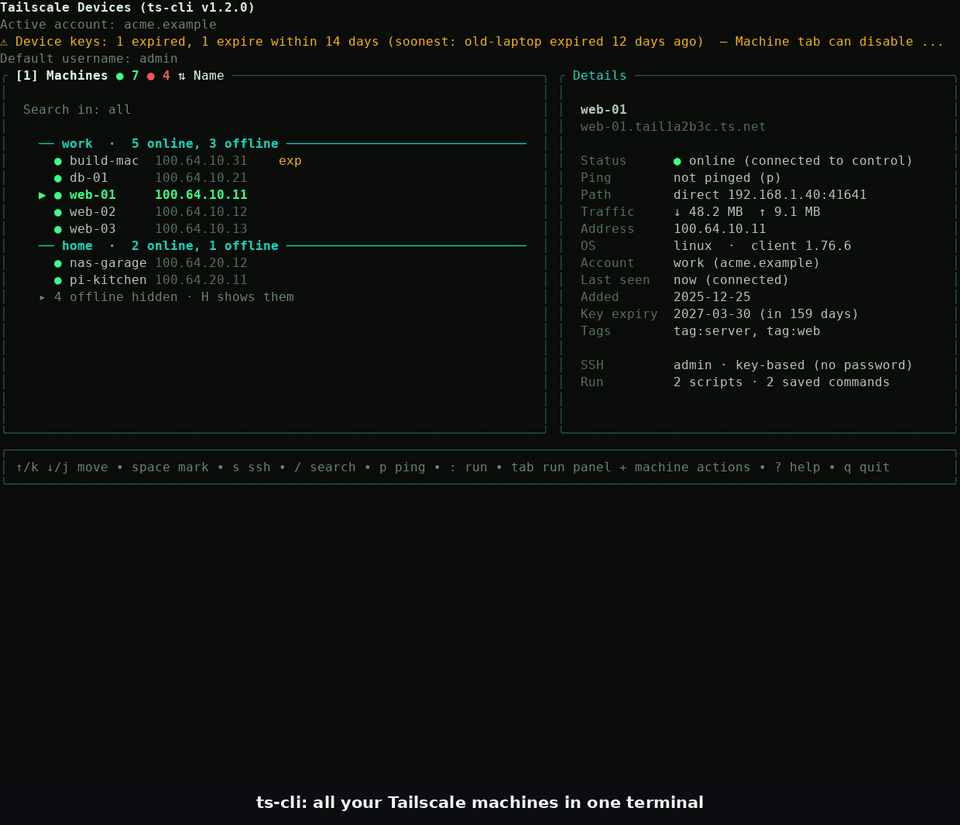
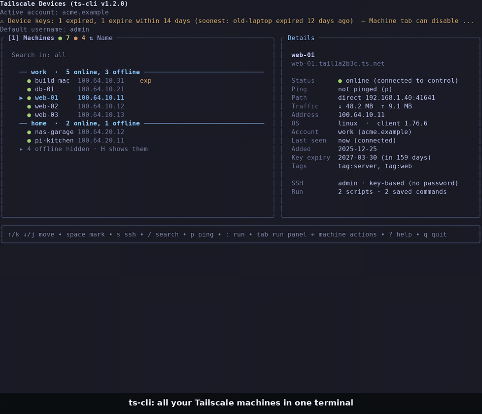
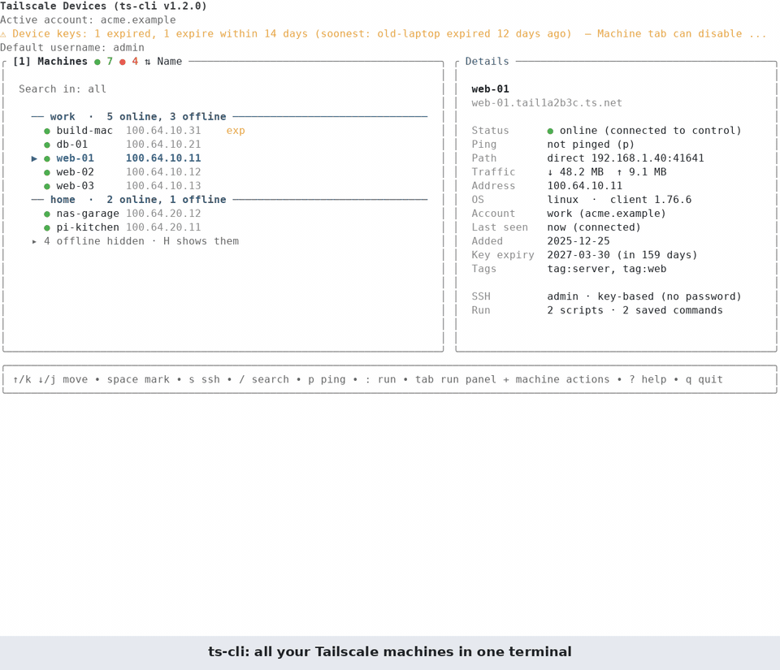

# Tailscale CLI (ts-cli)

[](https://github.com/yatsenko-ihor/ts-cli/actions/workflows/ci.yml)

A terminal tool for managing the machines of your Tailscale tailnets: browse them in a keyboard-driven TUI, connect over SSH, run scripts and commands on one or many machines, copy files, and manage devices and accounts through the Tailscale API.



The demo uses invented machines and a fake API ([how it is made](demo/README.md)); [MP4 version](docs/demo.mp4).

<details>
<summary>The same demo in the <b>dark</b> and <b>light</b> themes</summary>





[MP4: dark](docs/demo-dark.mp4) · [MP4: light](docs/demo-light.mp4)

</details>

## Highlights

- **Several accounts at once**: add, switch, hide and health-check tailnets; API keys are stored encrypted
- **Interactive TUI**: searchable machine list with online/offline state, details, themes (light, dark, dark-pastel, hacker, your own)
- **SSH done right**: key first, password only when needed and saved encrypted, optional tmux split and Tailscale SSH
- **Run panel**: local scripts, saved commands with `{{placeholders}}`, streaming output, runs on many machines in parallel
- **Files**: `scp` upload and download with local and remote file browsers
- **Machine actions**: ping details (direct or relay), key expiry, rename, tags, delete
- **Scriptable CLI**: `ts-cli list` with filters and JSON output, `ts-cli account`, `ts-cli ssh`

## Install

You need a Tailscale [API key](https://login.tailscale.com/admin/settings/keys). Optional: `sshpass` for saved-password logins.

**Download a binary** from the [Releases](https://github.com/yatsenko-ihor/ts-cli/releases) page (Linux, macOS and Windows, amd64 and arm64; `checksums.txt` lists SHA-256 sums), unpack it and put `ts-cli` on your `PATH`, or run `./ts-cli install`. On macOS a downloaded binary may be blocked by Gatekeeper: `xattr -d com.apple.quarantine ts-cli`.

**Or build it** (Go 1.24+):

```bash
go install github.com/yatsenko-ihor/ts-cli@latest
# or from source
git clone https://github.com/yatsenko-ihor/ts-cli.git && cd ts-cli && go build -o ts-cli .
```

## Quick start

```bash
export TAILSCALE_API_KEY=tskey-api-xxxxx
ts-cli login --tailnet=example.com     # validates the key and stores the account
ts-cli                                 # opens the TUI
ts-cli list --online --os linux        # scripting
```

In the TUI:

| Key | Action | Key | Action |
|---|---|---|---|
| `↑` `↓` / `j` `k` | move | `s` | SSH to the machine |
| `/` | search | `:` | run a command |
| `Space` / `*` | mark machine(s) | `Tab` | Run panel / machine actions |
| `p` | ping | `f` / `F` | upload / download files |
| `m` | accounts | `F12` | settings and themes |
| `?` / `F1` | help | `q` | quit |

## Documentation

- **[Detailed guide](docs/USAGE.md)**: all commands, keys and settings, scripts, multi-machine runs, copying files, themes, configuration and encryption, tmux
- [Security model](SECURITY.md): where secrets live and how to report a vulnerability
- [Verification](docs/do178c/README.md): requirements-based tests, traceability and the coverage gate
- [tmux usage](TMUX_USAGE.md)
- [`todo.md`](todo.md): what is done and what is planned

## Security in short

Config files are `0600`; SSH passwords and API keys are encrypted at rest (AES-256-GCM) and the master key can live in the OS keychain (`ts-cli secrets use keychain`); passwords are passed to `ssh` through a private pipe, never on a command line. Details in [SECURITY.md](SECURITY.md).

## License

MIT License + Commons Clause: free to use and modify, but cannot be sold commercially. See [LICENSE](LICENSE).

## Author

Ihor Yatsenko, yatsenko.ihor@gmail.com
